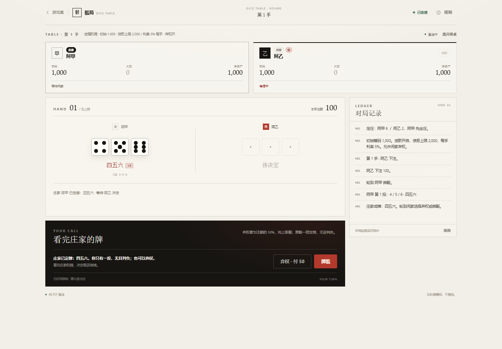

# 游戏集 / ARCADE

一个纯静态的双人游戏项目。当前收录第一款游戏：**骰局**（公平双人三骰回合制）。

- 无后端、无账号、无数据库
- 联机使用 WebRTC 数据通道直连
- 对局数据不会上传或保存
- 无需构建步骤，目录本身就是网站



## 在线访问

**GitHub Pages（永久）：https://42s94sj2mw-ops.github.io/arcade-games/**

游戏直达：**https://42s94sj2mw-ops.github.io/arcade-games/games/dice-table/**  
公开仓库：**https://github.com/42s94sj2mw-ops/arcade-games**

另有 BrewPage 临时镜像（unlisted，有效期至 **2026-11-25**）：  
https://my-aeyga3mrpr.brewpage.app/

同一链接可在任意联网电脑打开；双人联机仍由浏览器 WebRTC 直连，托管只负责发送静态文件。

---

## 快速运行

### 同一台设备试玩

直接打开 `index.html` 即可；也可以启动本地静态服务：

```bash
node tools/serve.js
```

终端会打印本机地址。同一设备打开即可试玩。

默认端口是 `4173`。如果需要换端口：

```powershell
# PowerShell
$env:PORT=8080; node tools/serve.js
```

```bash
# macOS / Linux
PORT=8080 node tools/serve.js
```

### 两台设备联机

两台设备必须打开**同一个页面地址**。选择任一方式：

1. 把整个 `Arcade/` 目录放到任意静态托管上，双方打开同一个 HTTPS 地址；
2. 在房主电脑上运行 `node tools/serve.js`，让两台设备处于同一局域网，客人打开终端打印的 `LAN` 地址。

> 这里的静态文件服务只负责把网页交给浏览器。房间连接与对局数据不经过它。

联机流程：

1. 房主创建房间，生成 **邀请码**；
2. 客人粘贴邀请码，生成 **应答码**；
3. 房主粘贴应答码，连接建立；
4. 房主开始对局。之后所有操作和牌局状态都通过 WebRTC 在两台设备间直连。

---

## 目录结构

```text
Arcade/
├─ index.html                  # 游戏大厅
├─ index.css                   # 大厅专用样式
├─ shared/
│  ├─ base.css                 # 统一设计 tokens、排版、按钮、弹窗
│  ├─ ui.js                    # 弹窗、toast、复制、骰子点数等公共 UI
│  └─ p2p.js                   # 纯前端 WebRTC 双码联机模块
├─ games/
│  └─ dice-table/              # 第一款游戏：骰局
│     ├─ index.html            # 游戏页面（大厅、联机、房间、牌桌、规则）
│     ├─ dice.css              # 游戏专用样式
│     ├─ engine.js             # 纯规则引擎（可在 Node 中测试）
│     └─ app.js                # 界面、房主权威状态同步、交互
├─ tests/
│  └─ engine.test.js           # 规则引擎 Node 测试
├─ tools/
│  └─ serve.js                 # 无依赖静态文件服务（仅本地/局域网）
└─ README.md
```

---

## 后续新增游戏的统一约定

为了让所有游戏能合并进同一个项目、保持文件形式一致，后续游戏按下面这套契约开发：

### 1. 每个游戏一个独立目录

```text
games/<slug>/
├─ index.html        # 必须有：页面入口，沿用统一头部、屏幕结构和共享样式
├─ <slug>.css        # 必须有：只写该游戏专属布局，颜色/字体/按钮优先复用 base.css
├─ engine.js         # 可选：纯规则逻辑；不含 DOM / 网络，可被 Node 测试
└─ app.js            # 必须有：界面、交互、联机调用
```

- 使用普通 `<script defer>` 和浏览器全局，不引入打包器。
- 共享模块固定为：
  - `ArcadeUI`（`shared/ui.js`）
  - `ArcadeP2P`（`shared/p2p.js`）
  - 游戏自己的引擎全局，例如 `DiceEngine`
- 页面必须从 `../../shared/base.css` 开始加载，再加载游戏专属 CSS。
- 新游戏继续沿用：
  - 暖纸色背景 + 墨色 + 单一朱红强调色的视觉体系；
  - 统一 `.site-head` / `.game-head` 顶部结构；
  - 统一 `.modal`、`.btn`、`.field`、`.tag`、`.screen` 等公共组件；
  - 极简、无外部图片/字体依赖、可离线打开。
- 联机游戏默认沿用 `shared/p2p.js` 的双码握手与房主权威状态同步方式，不引入后端。
- 需要持久保存的内容不要写进对局引擎；当前项目不保存任何对局数据。

### 2. 加入大厅

在根目录 `index.html` 中新增一张游戏卡片，更新顶部编号/统计即可。卡片视觉沿用现有结构：暗色视觉区、编号、名称、简介、玩家人数/标签、进入链接。

### 3. 测试

有纯规则引擎的游戏在 `tests/` 下增加 Node 测试，使用内置 `node:test` 和 `node:assert`，不引入测试框架。

---

## 当前游戏：骰局

### 已实现

- 公平规则、三颗骰子、无 AI、无回合倒计时。
- 房主自定义：对局模式、初始筹码、是否允许贷款、债务上限、每手利率、是否允许弃权。
- 两种对局模式：标准局（原著，最多三投）与全随机局（一掷定局，不重投）。
- 双人跨设备联机；联机码两段式握手；无房间服务器。
- 完整规则说明页。
- 贷款 / 还款（金额自选）、复利计息、主动借款触顶终局、强制借款赔付。
- 闲家弃权（仅庄家成牌后可弃，付半注向上取整）。
- 双方准备后轮庄。
- 终局结算页、断线提示、离开牌桌确认。
- 桌面与移动端响应式布局。

### 核心规则

- 双方初始筹码相同，由房主设置。
- 首手由双方各掷一颗骰子定庄，之后每手轮庄。
- **标准局**：闲家下注后，庄家最多三投，无目自动重掷全部三颗骰子，出现有效牌型即停；庄家最终无目或掷出 123 时本手直接结束，闲家不用掷。闲家同样最多三投。
- **全随机局**：双方各只投一次，所有原始结果直接结算；无目立即判负，123 立即输两倍，不重投、不选骰。庄家无目或 123 时闲家不用掷。
- 赢家按自己的牌型倍数收注：111 五倍、222–666 三倍、456 两倍、普通目一倍；123 无条件输两倍、无目输一倍。
- 同样的牌型判和局。不同数字的豹子按数字比大小。
- 贷款开启时：
  - 双方可在下注前/本手结束后借款、还款；
  - 每手结束后按未还欠款计息，向上取整并入欠款；
  - 筹码不足赔付时自动借款补齐，赢家收足；
  - 欠款达到债务上限立即终局，主动借款触顶同样终局；
  - 最后一手赔付/利息可以把欠款推过上限，结算完成后立即终局。
- 无贷款模式下，赔付以输家剩余筹码封顶；输家归零即终局。
- 弃权：仅闲家、看完庄家有效牌型后、掷骰前可弃，支付注额的 50%（向上取整）。
- 双方都准备后进入下一手；无时间限制。

完整细节以游戏内规则页为准。

---

## 已知限制

- **联机码是长文本**，需要自己通过聊天软件交换；目前没有短码/二维码。
- **公共 STUN，无 TURN**：大多数家庭网络可直连，但对称型 NAT、严格公司网络或部分移动网络可能无法建立连接。没有中继服务器，无法保证 100% 连通。
- **断线不恢复**：刷新、关闭页面或断网后本局结束，不能续局。
- **房主权威**：房主端运行规则与随机数；这是为轻量双人游戏做的取舍，不提供抗主机篡改的密码学证明。
- 对局状态只存在内存里，不保存记录；没有复盘/观战/聊天。
- 没有真实货币，所有筹码仅为游戏数值。

---

## 测试

```bash
node tests/engine.test.js
```

测试覆盖牌型识别、强弱比较、完整交手、弃权、无目、单投全随机模式、自动赔付、贷款、复利、债务上限、无贷款封顶终局等规则。
